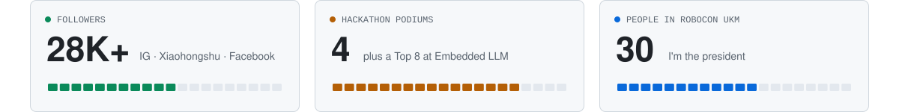
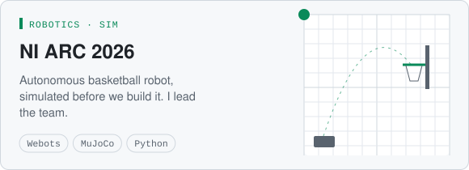
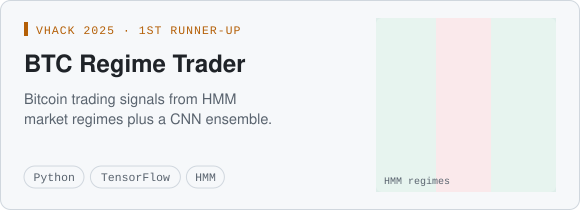

<picture>
  <source media="(prefers-color-scheme: dark)" srcset="assets/header-dark.svg">
  
</picture>

  
  
  

I'm a third-year EE student at UKM in Kuala Lumpur. Most days I'm splitting time between a robot that has to score on its own, some code that has to work by the deadline, and a one-minute video teaching someone how to get a small job done with AI.

<picture>
  <source media="(prefers-color-scheme: dark)" srcset="assets/readouts-dark.svg">
  
</picture>

## Things I've built

<table>
<tr>
<td width="50%"><picture><source media="(prefers-color-scheme: dark)" srcset="assets/card-nirc-dark.svg"></picture></td>
<td width="50%"><picture><source media="(prefers-color-scheme: dark)" srcset="assets/card-arena-dark.svg"></picture></td>
</tr>
<tr>
<td><picture><source media="(prefers-color-scheme: dark)" srcset="assets/card-fpga-dark.svg"></picture></td>
<td><a href="https://github.com/ngai123/2025"><picture><source media="(prefers-color-scheme: dark)" srcset="assets/card-vhack-dark.svg"></picture></a></td>
</tr>
<tr>
<td><a href="https://github.com/ngai123/2025"><picture><source media="(prefers-color-scheme: dark)" srcset="assets/card-umact-dark.svg"></picture></a></td>
<td><a href="https://github.com/diwenne/openreply"><picture><source media="(prefers-color-scheme: dark)" srcset="assets/card-openreply-dark.svg"></picture></a></td>
</tr>
</table>

<b>Where the code lives</b> (click)

 

- [`2025`](https://github.com/ngai123/2025): competitions and hackathons (Vhack, UM Hackathon, ROBOCON, UMACT, SharkTank UKM, UM Datathon). Public.
- `2026`: this year's projects and forks. Private for now. Ask me if you want a look.

## Podium so far

<picture>
  <source media="(prefers-color-scheme: dark)" srcset="assets/podium-dark.svg">
  
</picture>

<b>Outside the code</b> (click)

 

| | |
|---|---|
| ROBOCON UKM | President, 30-person team |
| NI ARC 2026 | Team captain, LabVIEW |
| Gamuda AI Academy | AI Lead |
| Kuok Foundation | Scholar |
| Axiata ULDP | Scholar |
| `@markues_success` | Daily series: *one minute, one small problem solved with AI* (in Chinese) |

## Toolbox

<picture>
  <source media="(prefers-color-scheme: dark)" srcset="https://skillicons.dev/icons?i=py,cpp,ts,dart,pytorch,tensorflow,sklearn,opencv,arduino,raspberrypi,fastapi,nextjs,flutter,docker,linux,gcp&theme=dark&perline=8">
  
</picture>

Plus VHDL on Vivado, ESP32, LabVIEW, and Hugging Face.

## Commit history, eaten daily

<picture>
  <source media="(prefers-color-scheme: dark)" srcset="https://raw.githubusercontent.com/ngai123/ngai123/output/github-snake-dark.svg">
  
</picture>
